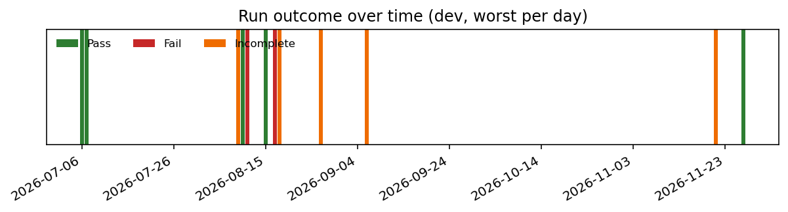
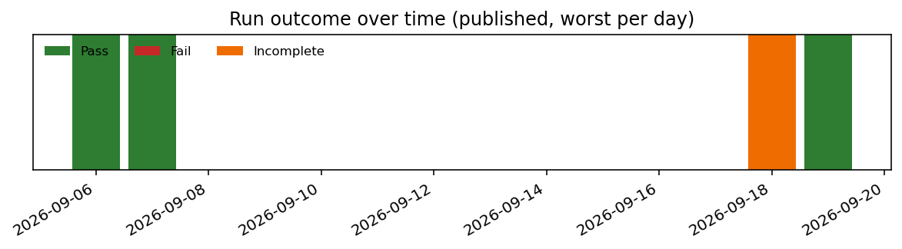
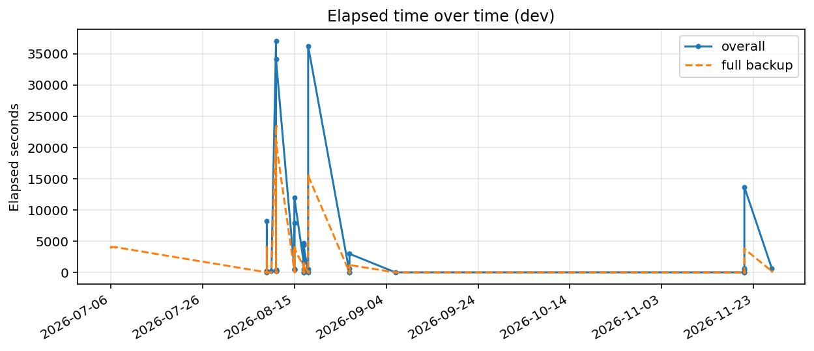
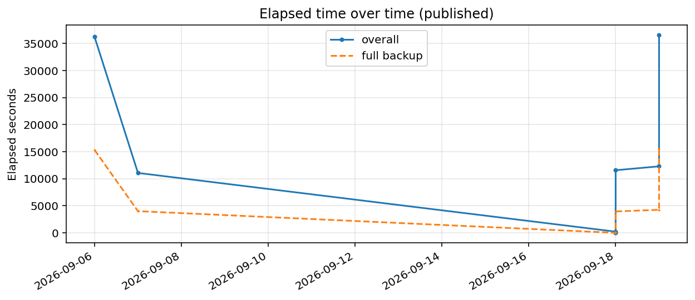
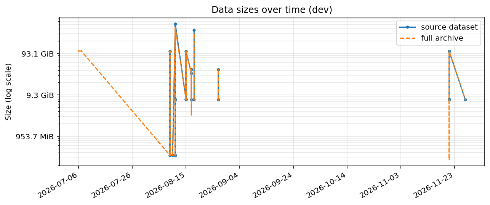
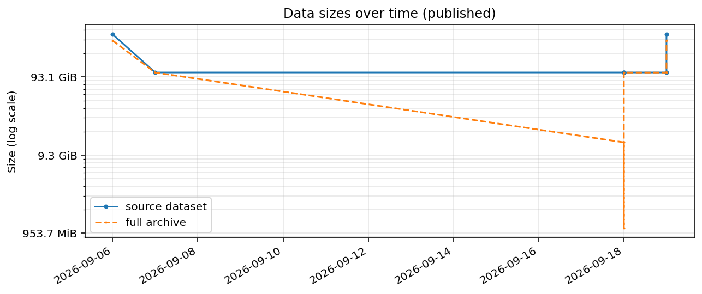
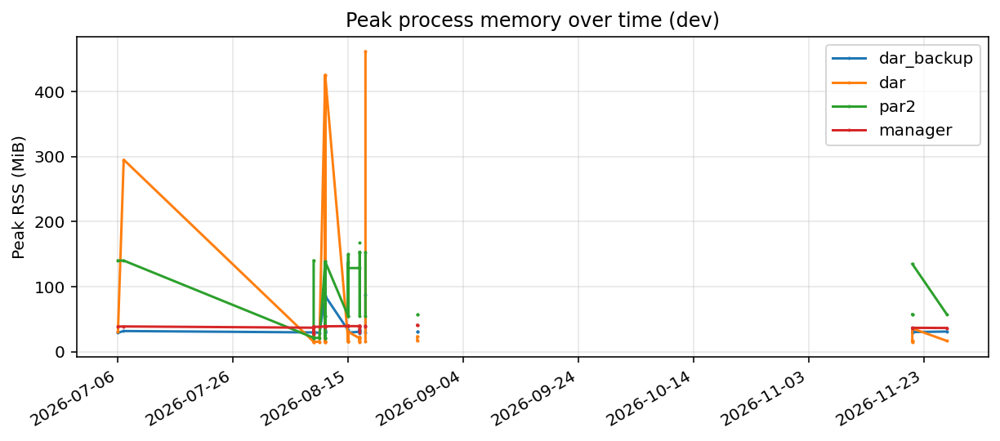
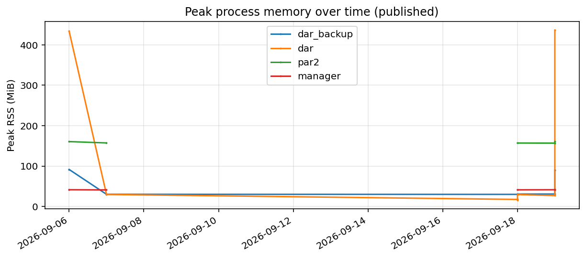

<!--
SPDX-FileCopyrightText: 2025-2026 Per Jensen

SPDX-License-Identifier: GPL-3.0-or-later

This file is part of dar-backup-image:
https://github.com/per2jensen/dar-backup-image

License terms and warranty disclaimer:
https://github.com/per2jensen/dar-backup-image/blob/main/LICENSE
-->

# Test reports at a page

_Generated 2026-11-28T09:12:24+01:00 from `doc/test-report/large-scale-results.jsonl` (48 runs)._

## Summary

| Metric | Value |
| --- | --- |
| Runs | 48 |
| Outcome | ✅ 34 pass, ❌ 2 fail, ⚠️ 12 incomplete |
| Dev runs | 41 (29 pass, 2 fail, 10 incomplete) |
| Published runs | 7 (5 pass, 0 fail, 2 incomplete) |
| Date range | 2026-07-06 to 2026-11-27 |
| dar-backup versions | 1.1.10, 1.1.11, 1.1.11.dev52, 1.1.12, 1.1.9 |
| Test profiles | Large scale torture test, Real life SteamLibrary, Real life media from 2013 |
| Operating systems | Ubuntu 24.04.4 LTS, Ubuntu 26.04.1 LTS |
| Kernels | 6.17.0-35-generic, 7.0.0-28-generic, 7.0.0-30-generic, 7.0.0-43-generic |

## Latest run

| Field | Value |
| --- | --- |
| Date | 2026-11-27 |
| Test | Large scale torture test |
| Image version | dev |
| dar-backup | 1.1.12 |
| Result | ✅ Pass |
| Full backup | 2m 48s |
| Overall | 10m 1s |
| Source dataset | 7.3 GiB |
| Full archive | 7.3 GiB |
| Peak RSS | 57.3 MiB |
| Bitrot method | fragmented @ 2% |
| Bitrot extent | 32.4 MiB / 20 regions |

## Runs

| Date | Test | Image | dar-backup | Result | Full (s) | Overall (s) | Source | Archive | Peak RSS | Bitrot method | Bitrot extent |
| --- | --- | --- | --- | --- | ---: | ---: | ---: | ---: | ---: | --- | --- |
| 2026-07-06 | — | — | 1.1.9 | ✅ Pass | 4,073 | — | — | 108.2 GiB | 140.0 MiB | — | — |
| 2026-07-07 | — | — | 1.1.10 | ✅ Pass | 4,050 | — | — | 108.2 GiB | 295.3 MiB | — | — |
| 2026-08-09 | — | dev | 1.1.10 | ⚠️ Incomplete | 7 | 233 | 330.9 MiB | 330.7 MiB | 36.8 MiB | — | — |
| 2026-08-09 | — | dev | 1.1.10 | ✅ Pass | 4,028 | 8,257 | 106.6 GiB | 106.2 GiB | 140.1 MiB | — | — |
| 2026-08-09 | — | dev | 1.1.10 | ⚠️ Incomplete | 0 | 11 | 106.6 GiB | 425.8 MiB | 27.8 MiB | — | — |
| 2026-08-09 | — | dev | 1.1.10 | ✅ Pass | 7 | 203 | 330.9 MiB | 330.7 MiB | 38.2 MiB | 2% | 18.6 MiB |
| 2026-08-10 | — | dev | 1.1.10 | ✅ Pass | 5 | 203 | 330.9 MiB | 330.7 MiB | 38.1 MiB | 2% | 18.6 MiB |
| 2026-08-11 | — | dev | 1.1.10 | ❌ Fail | 23,453 | 37,045 | 486.6 GiB | 395.3 GiB | 425.5 MiB | contiguous @ 2% | 217.8 MiB / 2 regions |
| 2026-08-11 | — | dev | 1.1.10 | ✅ Pass | 7 | 204 | 330.9 MiB | 330.7 MiB | 38.1 MiB | contiguous @ 2% | 18.6 MiB / 3 regions |
| 2026-08-11 | — | dev | 1.1.10 | ✅ Pass | 5 | 202 | 330.9 MiB | 330.7 MiB | 38.1 MiB | fragmented @ 2% | 18.6 MiB / 17 regions |
| 2026-08-11 | — | dev | 1.1.10 | ✅ Pass | 6 | 202 | 330.9 MiB | 330.7 MiB | 38.3 MiB | fragmented @ 2% | 18.6 MiB / 19 regions |
| 2026-08-11 | — | dev | 1.1.10 | ✅ Pass | 156 | 415 | 7.3 GiB | 7.3 GiB | 54.6 MiB | fragmented @ 2% | 32.4 MiB / 10 regions |
| 2026-08-11 | — | dev | 1.1.10 | ✅ Pass | 89 | 340 | 7.3 GiB | 7.3 GiB | 54.6 MiB | edges @ 2% | 6.0 MiB / 6 regions |
| 2026-08-11 | Large scale torture test | dev | 1.1.10 | ✅ Pass | 20,821 | 34,089 | 486.6 GiB | 398.9 GiB | 425.5 MiB | fragmented @ 2% | 217.9 MiB / 25 regions |
| 2026-08-15 | Large scale torture test | dev | 1.1.10 | ✅ Pass | 199 | 452 | 7.3 GiB | 7.3 GiB | 54.6 MiB | edges @ 2% | 6.0 MiB / 6 regions |
| 2026-08-15 | Large scale torture test | dev | 1.1.11.dev52 | ✅ Pass | 120 | 381 | 7.3 GiB | 7.3 GiB | 54.6 MiB | fragmented @ 2% | 32.4 MiB / 27 regions |
| 2026-08-15 | Large scale torture test | dev | 1.1.11.dev52 | ✅ Pass | 4,018 | 7,962 | 106.6 GiB | 106.2 GiB | 149.8 MiB | contiguous @ 2% | 421.6 MiB / 3 regions |
| 2026-08-15 | Large scale torture test | dev | 1.1.11.dev52 | ✅ Pass | 169 | 487 | 7.3 GiB | 7.3 GiB | 54.6 MiB | fragmented @ 2% | 32.4 MiB / 24 regions |
| 2026-08-15 | Large scale torture test | dev | 1.1.11.dev52 | ✅ Pass | 97 | 512 | 7.3 GiB | 7.3 GiB | 137.1 MiB | fragmented @ 2% | 161.7 MiB / 19 regions |
| 2026-08-15 | Large scale torture test | dev | 1.1.11.dev52 | ✅ Pass | 3,859 | 11,961 | 106.6 GiB | 106.2 GiB | 128.6 MiB | edges @ 2% | 6.0 MiB / 6 regions |
| 2026-08-17 | Large scale torture test | dev | 1.1.11 | ✅ Pass | 950 | 1,717 | 31.4 GiB | 31.3 GiB | 128.6 MiB | edges @ 2% | 127.6 MiB / 6 regions |
| 2026-08-17 | Large scale torture test | dev | 1.1.11 | ⚠️ Incomplete | 0 | 50 | 38.3 GiB | 3.1 GiB | 30.1 MiB | — | — |
| 2026-08-17 | Large scale torture test | dev | 1.1.11 | ✅ Pass | 1,472 | 4,693 | 38.3 GiB | 38.3 GiB | 168.1 MiB | edges @ 2% | 795.9 MiB / 6 regions |
| 2026-08-17 | Large scale torture test | dev | 1.1.11 | ⚠️ Incomplete | 0 | 3 | — | — | — | — | — |
| 2026-08-17 | Large scale torture test | dev | 1.1.11 | ❌ Fail | 1,313 | 4,364 | 38.3 GiB | 38.3 GiB | 152.9 MiB | edges @ 2% | 403.9 MiB / 6 regions |
| 2026-08-17 | Large scale torture test | dev | 1.1.11 | ✅ Pass | 188 | 514 | 7.3 GiB | 7.3 GiB | 54.6 MiB | fragmented @ 2% | 32.4 MiB / 24 regions |
| 2026-08-17 | Large scale torture test | dev | 1.1.11 | ✅ Pass | 1,274 | 4,391 | 38.3 GiB | 38.3 GiB | 153.0 MiB | edges @ 2% | 403.9 MiB / 6 regions |
| 2026-08-18 | Large scale torture test | dev | 1.1.11 | ⚠️ Incomplete | 0 | 2 | — | — | — | — | — |
| 2026-08-18 | Large scale torture test | dev | 1.1.11 | ✅ Pass | 170 | 483 | 7.3 GiB | 7.3 GiB | 54.6 MiB | edges @ 2% | 25.4 MiB / 6 regions |
| 2026-08-18 | Large scale torture test | dev | 1.1.11 | ✅ Pass | 15,474 | 36,228 | 350.3 GiB | 272.1 GiB | 461.8 MiB | edges @ 2% | 342.1 MiB / 6 regions |
| 2026-08-27 | Large scale torture test | dev | 1.1.11 | ⚠️ Incomplete | 0 | 2 | — | — | — | fragmented @ 2% | — |
| 2026-08-27 | Large scale torture test | dev | 1.1.11 | ⚠️ Incomplete | 0 | 2 | — | — | — | fragmented @ 2% | — |
| 2026-08-27 | Large scale torture test | dev | 1.1.11 | ✅ Pass | 178 | 625 | 7.3 GiB | 7.3 GiB | 57.3 MiB | fragmented @ 2% | 32.4 MiB / 15 regions |
| 2026-08-27 | Large scale torture test | dev | 1.1.11 | ✅ Pass | 1,183 | 2,983 | 38.3 GiB | 38.3 GiB | 57.3 MiB | edges @ 2% | 25.1 MiB / 6 regions |
| 2026-09-06 | Real life SteamLibrary | dev | 1.1.11 | ⚠️ Incomplete | 0 | 5 | — | — | — | edges @ 2% | — |
| 2026-09-06 | Real life SteamLibrary | 1.0.0-rc1 | 1.1.11 | ✅ Pass | 15,322 | 36,240 | 326.9 GiB | 272.3 GiB | 434.1 MiB | edges @ 2% | 343.7 MiB / 6 regions |
| 2026-09-07 | Real life media from 2013 | 1.0.0-rc1 | 1.1.11 | ✅ Pass | 4,008 | 11,070 | 106.6 GiB | 106.2 GiB | 157.2 MiB | contiguous @ 2% | 421.6 MiB / 3 regions |
| 2026-09-18 | Real life media from 2013 | 1.0.0-rc2 | 1.1.11 | ⚠️ Incomplete | 0 | 217 | 106.6 GiB | 13.6 GiB | 29.8 MiB | contiguous @ 2% | — |
| 2026-09-18 | Real life media from 2013 | 1.0.0-rc2 | 1.1.11 | ⚠️ Incomplete | 0 | 20 | 106.6 GiB | 1.1 GiB | 30.0 MiB | contiguous @ 2% | — |
| 2026-09-18 | Real life media from 2013 | 1.0.0-rc2 | 1.1.11 | ✅ Pass | 3,950 | 11,572 | 106.6 GiB | 106.2 GiB | 157.0 MiB | contiguous @ 2% | 421.6 MiB / 3 regions |
| 2026-09-19 | Real life media from 2013 | 1.0.0 | 1.1.11 | ✅ Pass | 4,259 | 12,291 | 106.6 GiB | 106.2 GiB | 156.7 MiB | contiguous @ 2% | 421.6 MiB / 3 regions |
| 2026-09-19 | Real life SteamLibrary | 1.0.0 | 1.1.11 | ✅ Pass | 15,504 | 36,566 | 327.7 GiB | 272.6 GiB | 436.6 MiB | edges @ 2% | 347.0 MiB / 6 regions |
| 2026-11-21 | Large scale torture test | dev | 1.1.12 | ⚠️ Incomplete | 1 | 7 | 7.3 GiB | — | — | fragmented @ 2% | — |
| 2026-11-21 | Large scale torture test | dev | 1.1.12 | ✅ Pass | 175 | 603 | 7.3 GiB | 7.3 GiB | 57.4 MiB | fragmented @ 2% | 32.4 MiB / 23 regions |
| 2026-11-21 | Large scale torture test | dev | 1.1.12 | ✅ Pass | 100 | 426 | 7.3 GiB | 7.3 GiB | 57.3 MiB | fragmented @ 2% | 32.4 MiB / 23 regions |
| 2026-11-21 | Large scale torture test | dev | 1.1.12 | ⚠️ Incomplete | 0 | 12 | 106.6 GiB | 267.7 MiB | 29.2 MiB | edges @ 2% | — |
| 2026-11-21 | Large scale torture test | dev | 1.1.12 | ✅ Pass | 3,787 | 13,665 | 106.6 GiB | 106.3 GiB | 134.9 MiB | edges @ 2% | 178.5 MiB / 6 regions |
| 2026-11-27 | Large scale torture test | dev | 1.1.12 | ✅ Pass | 168 | 601 | 7.3 GiB | 7.3 GiB | 57.3 MiB | fragmented @ 2% | 32.4 MiB / 20 regions |

## Failures and incomplete runs

| Date | Test | Result | Aborted phase | Exit code | Failures |
| --- | --- | --- | --- | ---: | ---: |
| 2026-08-09 | — | ⚠️ Incomplete | incr_verification:interrupted | 130 | 0 |
| 2026-08-09 | — | ⚠️ Incomplete | full_backup:interrupted | 130 | 0 |
| 2026-08-11 | — | ❌ Fail | — | 1 | 2 |
| 2026-08-17 | Large scale torture test | ⚠️ Incomplete | full_backup:interrupted | 130 | 0 |
| 2026-08-17 | Large scale torture test | ⚠️ Incomplete | setup | 1 | 0 |
| 2026-08-17 | Large scale torture test | ❌ Fail | — | 1 | 1 |
| 2026-08-18 | Large scale torture test | ⚠️ Incomplete | setup | 1 | 0 |
| 2026-08-27 | Large scale torture test | ⚠️ Incomplete | setup | 1 | 0 |
| 2026-08-27 | Large scale torture test | ⚠️ Incomplete | setup | 1 | 0 |
| 2026-09-06 | Real life SteamLibrary | ⚠️ Incomplete | setup:interrupted | 130 | 0 |
| 2026-09-18 | Real life media from 2013 | ⚠️ Incomplete | full_backup:interrupted | 130 | 0 |
| 2026-09-18 | Real life media from 2013 | ⚠️ Incomplete | full_backup:interrupted | 130 | 0 |
| 2026-11-21 | Large scale torture test | ⚠️ Incomplete | full_backup | 1 | 1 |
| 2026-11-21 | Large scale torture test | ⚠️ Incomplete | full_backup:interrupted | 130 | 0 |

## Charts

<table width="100%">
<tr><th>Dev</th><th>Published</th></tr>
<tr>
<td width="50%">

</td>
<td width="50%">

</td>
</tr>
<tr>
<td width="50%">

</td>
<td width="50%">

</td>
</tr>
<tr>
<td width="50%">

</td>
<td width="50%">

</td>
</tr>
<tr>
<td width="50%">

</td>
<td width="50%">

</td>
</tr>
</table>

---

_Generated by `scripts/test_reports_at_a_page.py`._
